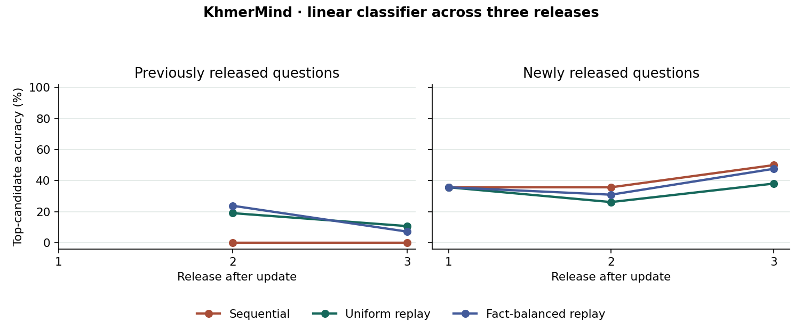

# What the first KhmerMind benchmark found

The experiment uses 30 synthetic glossary facts and three releases of ten facts each. Test questions use different wording from training records. The same held-out questions were scored across the methods and release orders. Numbers below are about this small synthetic glossary.

[Full test tables](results.md) · [Per-question predictions and settings](benchmark-runs.json.gz) · [Data notes](../data/README.md)



## What happened

- In the standard release order, the **linear classifier with uniform replay** ended at **10.7% old top-candidate accuracy** and **20.2 percentage points of forgetting**. Sequential training ended at **0% old accuracy** and **35.7 points of forgetting**. New top-candidate accuracy moved from **50.0% to 38.1%** with replay.
- In the alternate order, the same linear replay method reached **20.2% old top-candidate accuracy**. The FFN also retained more old answers with uniform replay, though the effect was smaller. Fact-balanced replay was inconsistent across the two orders and backbones.
- Rejection thresholds had a large effect. At the final release, retrieval answered **19.0% of known test questions correctly** and falsely answered **25.0% of out-of-scope questions**. Some linear runs abstained on nearly everything. The FFN answered more unknowns incorrectly. Both patterns are visible in the coverage and error columns.

The browser demo uses the retrieval baseline and displays the matched answer version and source. Its exact-phrasing examples illustrate the release behavior. The held-out evaluation is a better guide to performance when real users use new wording.

## See a run without launching the demo

| Selected release | Query | Output |
| --- | --- | --- |
| 1 | «តើចំណូលសុទ្ធមានន័យដូចម្តេច?» | `net_revenue_v1` with the Khmer definition. |
| 1 | «តើស្តុកបម្រុងជាអ្វី?» | `UNKNOWN`. |
| 3 | «តើស្តុកបម្រុងជាអ្វី?» | `safety_stock_v1` with the Khmer definition. |
| 3 | «តើថ្ងៃនេះសីតុណ្ហភាពប៉ុន្មាន?» | `UNKNOWN`. |

## Three observed errors

| Test question | Expected | What happened |
| --- | --- | --- |
| «តើ AOV រាប់ការបញ្ជាទិញដែលបានបញ្ចប់ឬការចូលមើលទំព័រ?» | Average order value | Retrieval chose completed orders. The question mentions both concepts. |
| «តើរយៈពេលធានាទំនិញមានប៉ុន្មានខែ?» | Out of scope | Retrieval answered with lead time. Both questions involve a duration. |
| «បន្ទាប់ពីដកការបញ្ចុះតម្លៃ និងការសងប្រាក់ តើគួររាយការណ៍ចំណូលប្រភេទណា?» | Net revenue | Retrieval ranked net revenue first but abstained. The acceptance policy filters ambiguous rankings. |

## How the comparison was made

- The main order was sales, customers, then inventory. The sensitivity run used inventory, sales, then customers. Both models used hashed Unicode 2-, 3-, and 4-grams, and the FFN had 32 hidden units.
- For each of the seeds 7, 19, and 37, warm-start methods started from the same release-1 checkpoint. Each sequential or replay update took 240 steps with a minibatch size of eight. Replay used four old draws per update step and stored up to 24 examples. The full-history reference retrained with all released examples and a longer schedule.
- The score and gap cutoffs for retrieval are 0.35 and 0.10. The neural maximum-probability cutoff is 0.20. These are shared baselines selected after inspecting validation runs, including the trade-off between coverage and false answers. The held-out test was run after fixing the configuration.
- Top-candidate results quantify changes in ranking before the rejection rule. Known accuracy, unknown false answers, and coverage quantify what users see after the rule. Report the two views together.
- Validation and test each contain eight unknowns, so one false answer changes the rate by 12.5 points in a single run. The synthetic questions have not received independent Khmer review. These data are suitable for a first reproducible case study.

## Recreate the report

Use Python 3.11 or newer. From the checkout root, install the plotting dependencies and run the four cases:

```bash
python3 -m pip install -r requirements-report.txt
python3 -m khmer_learning benchmark --model linear --split test --order 1 2 3 --output reports/generated/linear-123-test.json
python3 -m khmer_learning benchmark --model ffn --split test --order 1 2 3 --output reports/generated/ffn-123-test.json
python3 -m khmer_learning benchmark --model linear --split test --order 3 1 2 --output reports/generated/linear-312-test.json
python3 -m khmer_learning benchmark --model ffn --split test --order 3 1 2 --output reports/generated/ffn-312-test.json
python3 scripts/make_report.py reports/generated/linear-123-test.json reports/generated/ffn-123-test.json reports/generated/linear-312-test.json reports/generated/ffn-312-test.json
```

Update time depends on hardware and runtime load. The archive includes predictions, release matrices, data checksums, configuration, and timing for the published run.
